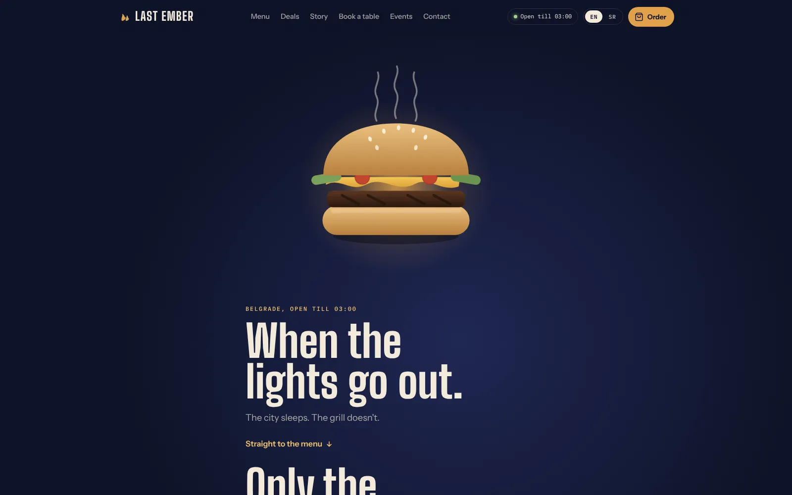

# Last Ember

Website concept for a made-up late-night burger bar in Belgrade. Menu, cart, table booking and an English/Serbian switch.

**Live:** https://nikolxdev.github.io/last-ember/

Plain HTML, CSS and JavaScript, no frameworks and no build step. Just open `index.html` in a browser.

- `js/translations.js` – all text in English and Serbian
- `js/app.js` – menu, cart, booking and the rest of the logic
- `css/style.css` – styles, colors and fonts are at the top

Orders and bookings don't go anywhere, there's no backend. Phone and email are placeholders.

## License

© 2026 Nikola Vojvodić. All rights reserved. The code is public so it can be read and evaluated as part of my portfolio; it is not open source. See [LICENSE](LICENSE) for what is and isn't allowed.
